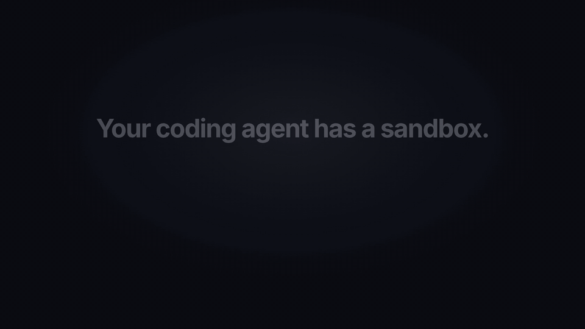

<p align="center"></p>

<h1 align="center">sandfit</h1>

<p align="center">
  <b>Turn on your coding agent's sandbox without breaking your work.</b><br>
  sandfit looks at what your agent (Claude Code or Codex) already did on your machine,<br>
  and writes sandbox rules that allow exactly that, and nothing more.
</p>

<p align="center">
  
  
  
</p>

<p align="center">
  <a href="demo/sandfit-demo.mp4"></a>
  <br><sub><b><a href="demo/sandfit-demo.mp4">▶ Watch with sound (MP4, 29 s)</a></b>· the terminal shows real sandfit output on a <a href="demo/sample-history.ts">sample history</a></sub>
</p>

## The problem, in one minute

Coding agents run commands on your computer: `npm install`, `git push`, `curl`, scripts.
If an agent is tricked (for example by a malicious README or web page), those same commands
could read your SSH keys or send your `.env` file somewhere.

A **sandbox** stops that. Claude Code has one (`/sandbox`), and so do Codex and other tools.
A sandbox blocks everything by default, so you have to tell it what is allowed: which
websites, which folders.

Nobody knows that list up front. So people turn the sandbox on, `npm install` fails, the
dev server fails, approvals pile up, and they turn it off again.

**sandfit writes that list for you.** Your agent's history already shows what you really use.
sandfit reads it, builds the rules, and shows you what would still break *before* you switch anything on.

## Quick start

You need Node.js 20 or newer. In your project folder, run:

```bash
npx sandfit
```

That only reads and prints. Nothing is changed, and nothing is sent anywhere.

If you like what you see, check exactly what would change in your project's Claude Code
settings, then write it (sandfit shows the changes, asks first and keeps a backup of the old file):

```bash
npx sandfit diff
```

```bash
npx sandfit apply --review
```

`--review` walks you through anything your history needed only once (one odd `curl`, one copy to
an unusual folder) so you can keep or drop each one. Enter keeps it.

Then turn the sandbox on in Claude Code with `/sandbox`.

The settings sandfit writes also tell Claude Code to stop with an error if the sandbox can't start
(`failIfUnavailable`), instead of quietly running commands without it.

Want unlisted websites refused instead of asked about? Write it to your user settings with strict
mode (Claude Code v2.1.219+; Claude Code ignores this setting in project settings):

```bash
npx sandfit apply --user --strict-network
```

### Let commands use your tokens without seeing them

If your agent uses secret environment variables (`curl -H "Authorization: Bearer $OPENAI_API_KEY" …`,
or `NPM_TOKEN` for npm), sandfit can tell Claude Code to **mask** them: sandboxed commands see a
placeholder, and Claude Code's sandbox proxy puts the real value back only on requests to the hosts
your history sent it to. A hijacked command can't read or leak the token, but your requests still work.

```bash
npx sandfit apply --user --mask-credentials
```

- sandfit records only variable **names** and where they were sent, never their values.
- A variable that history only used locally (say `echo "$DB_PASSWORD" > .env.local`) is not masked,
  because masking would break that.
- Masking uses Claude Code's experimental TLS termination (`sandbox.network.tlsTerminate`), and
  Claude Code only accepts it in user settings, hence `--user`. Afterwards run `claude doctor`: a
  `TLS termination is unavailable` warning means masking can't work on your setup.
- Run `sandfit explain env` to see which variables would be masked and for which hosts.

## What the output means

This is real output on the [sample history](demo/sample-history.ts) used in the video
(one week of a developer working on a Next.js app):

```text
sandfit 0.3.1  ·  read 243 tool calls from 12 sessions (Claude Code) · last 30 days
  project ~/code/storefront

  If you turn on the sandbox today
  ███████░░░░░░░░░░░░░░░░░  28% of your shell commands would break  (69 of 243)

  With the sandfit policy
  ░░░░░░░░░░░░░░░░░░░░░░░░  0% would break  (0 of 49 commands from your newest 20% of history, which the policy never saw)
  On the history it was built from: 0%
  2 commands that read secrets are blocked on purpose
  Manual approvals you would no longer need: 24 of 35
  11 commands run outside the sandbox (tools that cannot work inside it)

  What the policy allows
  Network   api.github.com, api.vercel.com, binaries.prisma.sh, cdn.playwright.dev, files.pythonhosted.org, github.com +4 more
  Writes    your project, temp, ~/.cache/ms-playwright, ~/.cache/pip, ~/.npm, ~/notes
  Servers   local dev servers may listen on ports
  Outside   docker, gh, git push run unsandboxed
  Denied    secrets (~/.ssh, ~/.aws, .env …) and the agent's own config
```

Line by line:

- **If you turn on the sandbox today**: how many of your past commands would fail with the sandbox on and no rules.
- **With the sandfit policy**: how many would still fail with sandfit's rules. This is an honest test: sandfit builds the rules from your *older* history and checks them on your *newest* 20%, which it did not look at.
- **Blocked on purpose**: commands that read secrets (here, `cat .env.local`). The sandbox should block those.
- **Manual approvals you would no longer need**: commands you had to approve by hand that the sandbox now allows safely.
- **Run outside the sandbox**: tools that cannot work inside a sandbox at all (Docker needs its daemon, `git push` and `gh` need your credentials). They are listed openly, so they keep asking you for approval.

Want to know why something is allowed? Ask:

```bash
npx sandfit explain github.com
```

```text
  Network: hosts your agent's commands reached
  ✓ github.com  needed 11 times
      e.g. git pull --rebase
  ✓ api.github.com  needed 2 times
      e.g. curl -s https://api.github.com/repos/vercel/next.js/releases/latest
```

## How it works

1. **Read your history.** Claude Code keeps transcripts in `~/.claude/projects`, Codex in `~/.codex/sessions`. sandfit reads the last 30 days of the current project, on your machine.
2. **Work out what each command needed.** It understands shell syntax (pipes, `cd`, `bash -c`, `sudo`, redirects, heredocs) and knows what common tools need behind the scenes: `npm install` talks to `registry.npmjs.org` and writes `~/.npm`; `pnpm dev` starts a local server; `git push` needs your SSH keys.
3. **Build the rules.** Only what was used, generalized carefully (a cache folder, not your whole home). Secrets are always denied, and so is the agent's own config, so a hijacked agent cannot switch its sandbox off.
4. **Check them.** It replays your history against the sandbox with and without the rules and shows you the difference.
5. **Write them** for the sandbox you use, keeping a backup.

## Which sandboxes it supports

| Sandbox | Command | What you get |
|---|---|---|
| **Claude Code** `/sandbox` | `sandfit apply` | Sandbox rules and secret `deny` rules merged into `.claude/settings.json` (add `--user` for `~/.claude/settings.json`, and there `--strict-network` to refuse unlisted hosts and `--mask-credentials` to mask tokens) |
| **Anthropic sandbox-runtime** (`srt`) | `sandfit apply -t srt` | `~/.srt-settings.json`, then run `srt claude` |
| **Codex CLI** | `sandfit apply -t codex` | `workspace-write` mode with the folders and network you need, in `~/.codex/config.toml`. `--codex-profile` writes a per-website permission profile instead (beta in Codex); sandfit won't mix the two styles, since Codex then silently ignores one |
| **nono** | `sandfit apply -t nono` | `~/.config/nono/profiles/sandfit.json`, then run `nono run --profile sandfit -- claude` |
| **NVIDIA OpenShell** | `sandfit emit -t openshell -o policy.yaml` | A sandbox policy for `openshell sandbox create --policy policy.yaml --provider claude-code -- claude`. Network rules apply to your agent and everything it starts (`--binary` to name other programs) |
| **Anything else** | `sandfit emit -t policy` | The rules as a YAML file, with how often each one was needed and an example |

To see a config without writing it, use `emit` instead of `apply`:

```bash
npx sandfit emit -t claude      # or srt, codex, nono, openshell, policy
```

## All commands

```bash
sandfit                     # summary: what breaks today, what breaks with the rules
sandfit forecast            # every command that would be blocked, grouped, with the fix
sandfit explain [text]      # why each rule exists: how often it was needed, one example
sandfit diff -t <target>    # what apply would change in your config, without writing
sandfit emit -t <target>    # print the config (claude, srt, codex, nono, openshell, policy)
sandfit apply -t <target>   # write it (shows the changes, asks first, keeps a backup)
sandfit apply --review      # first keep or drop each grant your history needed only once
sandfit learn               # what a sandbox blocked in past sessions, as suggestions
sandfit apply --learn       # first add the blocked things you recognise (Enter skips)
```

`sandfit diff` lists every grant it would add and summarizes the protection rules (secret and
self-protection denies) as a count; add `--full` to list those too. It also points out entries
already in your settings that this history never needed: apply keeps them, but you may want to
remove them by hand.

Options that work everywhere:

| Option | What it does |
|---|---|
| `--all` | Use the history of every project, not just this one |
| `--project <dir>` | Build the rules for this folder |
| `--days <n>` | How far back to look (default 30; `0` = everything) |
| `--harness claude` / `codex` | Only read one agent's history |
| `--min-count <n>` | Leave out anything used fewer than `n` times |
| `--holdout <fraction>` | How much of the newest history to hold back for the honest test (default `0.2`) |
| `--json` | Machine-readable output |

## Promises

sandfit will **not**:

- **Send your history anywhere.** No network calls, no telemetry. Anything that looks like a password or token is masked before it is printed or written.
- **Loosen your permissions.** It adds sandbox rules and secret *deny* rules. Extra allow rules for Claude Code's own tools are only added with `--with-permissions`.
- **Overwrite your settings.** It merges: your own values win, and a timestamped backup is kept. If your settings file is broken, it stops instead of replacing it.
- **Allow broad folders.** Never `~`, `/`, `~/Documents`, `~/Downloads`, `~/Library`, `~/.config` or a parent of your project.
- **Hide trade-offs.** If a tool needs a secret file (npm reads `~/.npmrc`), sandfit leaves that one file readable and tells you why.

## How do we know it works?

Every number below comes from code in [`bench/`](bench) and is in [BENCHMARKS.md](BENCHMARKS.md). Run `npm run bench` to check it on your machine.

- **Against a real sandbox.** sandfit's rules were run inside [Anthropic's sandbox-runtime](https://github.com/anthropics/sandbox-runtime) (bubblewrap on Linux, Seatbelt on macOS) with 26 probes: things the history needed (should work) and attacks like reading a planted fake SSH key, editing `~/.zshrc`, writing git hooks or calling an unknown website (should be blocked). **26 of 26** behaved correctly, and sandfit's forecast matched the real sandbox on **36 of 36** checks. This runs in CI on Linux and macOS.
- **Understanding commands.** On 64 hand-labelled commands that sandfit was *not* tuned on, it found what they need with **96% precision and 96% recall**. (On the 143 commands it was tuned on: 100% and 99.5%.) The misses are listed in BENCHMARKS.md.
- **Speed.** 100,000 tool calls (1.3 GB of transcripts) in about 5 seconds. A heavy month of real use is around 18,000 tool calls: about a second.

## Learn from what the sandbox blocked

History shows commands, not what a script does inside them. Once you have used your agent with the
sandbox on, the errors in those sessions fill that gap: a Python script that was refused
`api.acme.dev`, a build tool that couldn't write its cache.

```bash
npx sandfit learn
```

```text
  ? write    ~/.cache/mytool  blocked 1 time
      e.g. node build.mjs
  ? network  api.acme.dev  blocked 1 time
      e.g. python scripts/sync.py
  ? network  exfil.evil.example  blocked 1 time
      e.g. ./deploy.sh
```

None of these is added for you: a blocked attempt can also be an attack (look at that last one).
`sandfit apply --learn` asks about each, and Enter skips. sandfit never suggests secrets, shell
startup files, the agent's own config or broad folders. It only uses errors that name the host or
path (for example `Read-only file system` on Linux, `Operation not permitted` on macOS, or a failed
lookup that names the host), so a blocked `curl` that only says `CONNECT tunnel failed` teaches it nothing.

## Known limits

- sandfit sees **commands**, not everything a command does inside. If a script calls an API sandfit has never heard of, that website is not in the rules until you run it once with the sandbox on; then `sandfit learn` picks it up from the error. sandfit lists such tools under "Tools sandfit has no knowledge of".
- On **Linux**, every sandboxed command gets its own network, so a dev server started by one command cannot be reached by the next. That is how the sandbox works there, not something sandfit can change.
- The Codex, nono and OpenShell configs are checked against those tools' published schemas, but only sandbox-runtime (which Claude Code's sandbox is built on) is tested by actually running commands.

## Questions

**Do I need to install anything?** No. `npx sandfit` downloads and runs it. Node.js 20+ is the only requirement.

**Can I undo `apply`?** Yes. Every write keeps a copy of the old file next to it (`settings.json.sandfit-backup-<time>`). Copy it back.

**I use both Claude Code and Codex.** sandfit reads both by default. Use `--harness` to pick one.

**My agent has no history in this project yet.** sandfit falls back to all your projects and says so. Or work with your agent for a while and run it again.

## Development

```bash
npm install
npm test                 # unit, CLI, property and accuracy tests (130+)
npm run test:coverage    # the same, with coverage (about 95% of lines)
npm run test:sandbox     # end to end inside a real sandbox (needs bubblewrap + socat on Linux)
npm run bench            # all benchmarks; rewrites BENCHMARKS.md
npm run dev -- --all     # run the CLI from source
```

The demo video is a [HyperFrames](https://github.com/heygen-com/hyperframes) project in [`demo/video`](demo/video). See [demo/README.md](demo/README.md) to change and re-render it.

## Contributing

The most useful contribution is **knowledge**: one entry in [`src/extract/knowledge.ts`](src/extract/knowledge.ts) teaches sandfit what a tool needs (websites, cache folders) for everyone. Run `npx sandfit` and the line "Tools sandfit has no knowledge of" tells you which entries are missing for your setup. See [CONTRIBUTING.md](CONTRIBUTING.md).

## License

MIT
